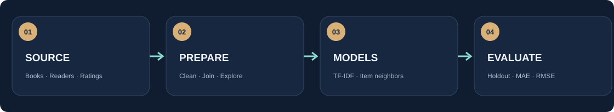
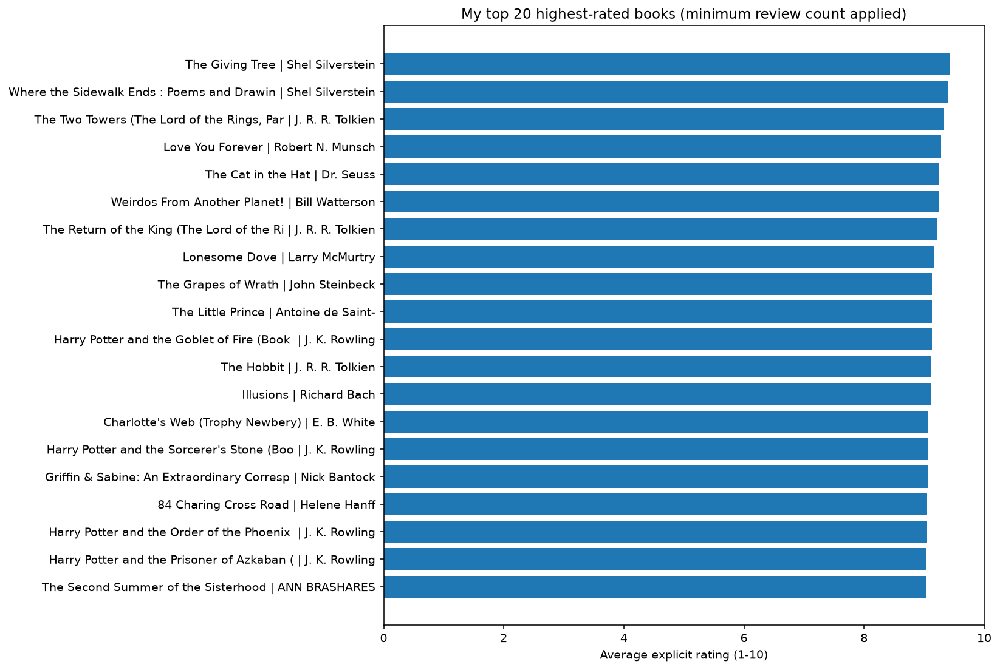
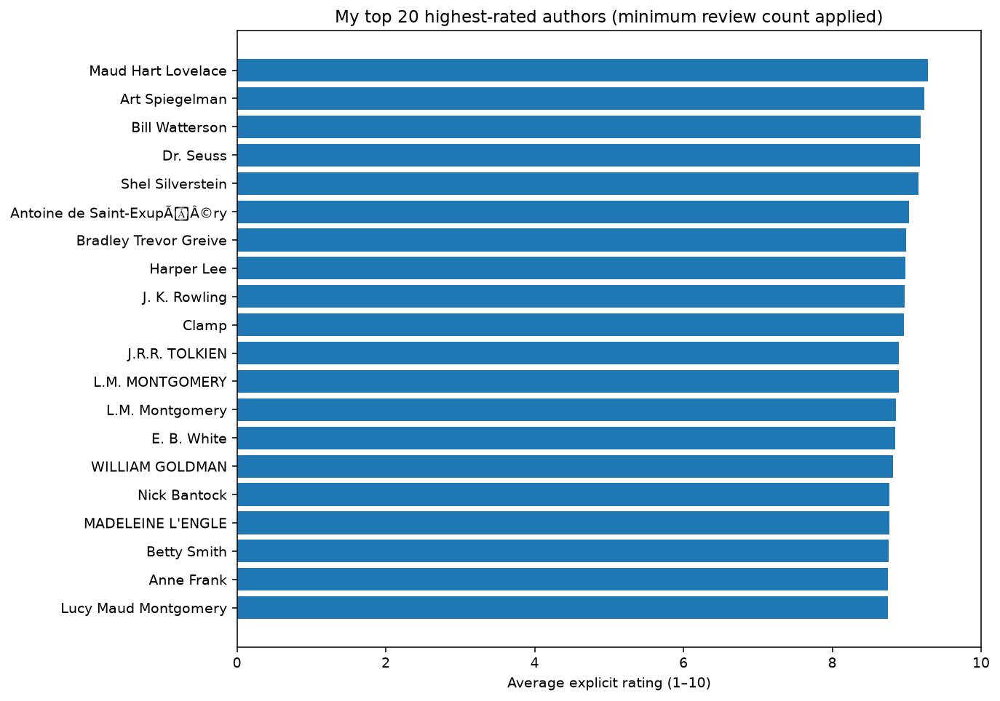
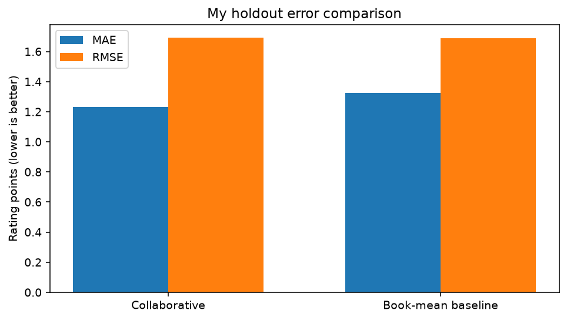

<div align="center">

# Book Recommendation Engine | Project 2

### Miami Dade College | CAI2100C-2267-6908 | Machine Learning Foundations

**Juan Luna Santibanez**  
**Professor Beth Muturi**  
**Unsupervised Learning and Recommendation Systems · November 2026**


**Books. Readers. Two recommendation methods. One reproducible study.**

I keep a course-aligned notebook separate from my optional research and visual presentation. I do not claim that my notebook is the unretrieved original class ZIP.

[**Course Notebook in Google Colab**](https://colab.research.google.com/github/SupaHumano/CAI2100C-Book-Recommendation-Engine/blob/main/academic/Project_2_Course_Submission.ipynb) · [**Academic Notebook**](academic/Project_2_Course_Submission.ipynb) · [**Research Notebook**](notebooks/Project_2_Book_Recommendation_Engine.ipynb) · [**Interactive Lab**](https://supahumano.github.io/CAI2100C-Book-Recommendation-Engine/) · [**Methodology**](docs/METHODOLOGY.md)

</div>


---

[**Course Requirements**](docs/REQUIREMENTS.md) · [**40 Questions and Answers**](docs/PRESENTATION_GUIDE.md) · [**Overview**](#overview) · [**Course project**](#course-project) · [**Methods**](#two-recommendation-methods) · [**Results**](#my-results) · [**Run**](#run-my-notebook) · [**Structure**](#repository-structure) · [**References**](#references)

## Overview

I created a practical book recommendation engine using the Book-Crossing dataset and two methods from my machine learning course: content-based filtering and collaborative filtering. My goal is to understand how available book metadata and reader ratings lead to different recommendations.

I follow the six-stage learning process used in class: understanding the problem, acquiring data, preparing and exploring the data, modeling, evaluating results, and considering responsible deployment. My academic notebook under `academic/` is the course-aligned study. My research notebook produces the optional website's figures and evaluation outputs.

## Course Project

Professor Beth Muturi described Project 2 as recommending **books rather than movies**, using the same underlying ideas introduced in Assignment 8. She described loading three tables (books, users and ratings), cleaning the data, visualizing the 20 highest-rated books and authors, and comparing content-based and collaborative filtering.

This repository is **my individual GitHub portfolio of the work**. Actual course submission and any group-member attribution follow the Canvas project instructions and my classroom arrangements; this README does not invent contributors or claim a separate group approval.

## Two Recommendation Methods

| Method | My implementation | What it answers |
|---|---|---|
| **Content-Based Filtering** | TF-IDF over title, author, publisher and year; cosine similarity | Which books have metadata similar to this book? |
| **Collaborative Filtering** | Sparse reader-book explicit ratings; item-item nearest neighbors | Which other books may fit this reader's recorded preferences? |



**Important:** a `Book-Rating` value of **0** in Book-Crossing is an implicit interaction, not a zero-star review. I use explicit ratings **1-10** for model evaluation. I retain ISBN identifiers as strings so leading zeros are preserved.

## My Results

### Highest-rated books and authors

| Highest-rated books | Highest-rated authors |
|:---:|:---:|
|  |  |

I combine explicitly recognized author-name variants and aggregate distinct book works by title and author. I apply a minimum number of explicit ratings before ranking by average score. This helps me avoid treating one isolated ten-star rating as stronger evidence than many consistent reviews.

### Collaborative evaluation



I separate the holdout before choosing training-eligible books and readers. I compare my model's holdout **MAE** and **RMSE** with a simple book-average baseline and report how often the algorithm has useful neighbors. Lower errors are better; I do not assume my collaborative model outperforms the baseline unless the numbers show it.

My evaluation on **9,126 known reader-book test ratings** produced:

| Model | MAE (lower is better) | RMSE (lower is better) |
|---|---:|---:|
| Item-based collaborative with fallback | **1.2319** | 1.6914 |
| Book-average baseline | 1.3235 | **1.6894** |

I improved MAE relative to the baseline, but the baseline had a slightly lower RMSE. Only **40.48%** of predictions had a positively similar rated neighbor; the remaining predictions used a stated fallback. These results describe my selected educational subset, not the entire Book-Crossing population.

My [interactive lab](https://supahumano.github.io/CAI2100C-Book-Recommendation-Engine/) displays the recommendations and metrics saved by my Python notebook. It does **not** retrain a model in JavaScript.

## My Course Requirements and Questions

I answer the introductory questions about dataset sources, machine learning types and the importance of AI. I organize the work into the six stages of our course framework and use the [requirements map](docs/REQUIREMENTS.md) to keep known instructions separate from my optional portfolio features. My [40-question guide](docs/PRESENTATION_GUIDE.md) helps me explain the methodology and limitations in first person.

## Data and Reproducibility

I use three Book-Crossing files: `Books.csv`, `Ratings.csv`, and `Users.csv`. The notebook first looks for those files locally. If they are missing, it downloads a public copy documented by [Microsoft Learn](https://learn.microsoft.com/en-us/fabric/data-science/retail-recommend-model). The source dataset is documented by [GroupLens](https://grouplens.org/datasets/book-crossing/).

The publicly available copy is a practical fallback, not a claim that I had the exact Project 2 ZIP used in class. I keep large source CSVs out of the Git history; the notebook calculates the recorded results directly from those files.

## Run My Notebook

### Google Colab

I open [my classroom-aligned notebook](https://colab.research.google.com/github/SupaHumano/CAI2100C-Book-Recommendation-Engine/blob/main/academic/Project_2_Course_Submission.ipynb) for the academic workflow. I use [my extended notebook](notebooks/Project_2_Book_Recommendation_Engine.ipynb) to recompute the website figures and additional evaluation records.


Open [my notebook in Google Colab](https://colab.research.google.com/github/SupaHumano/CAI2100C-Book-Recommendation-Engine/blob/main/notebooks/Project_2_Book_Recommendation_Engine.ipynb). Choose **Runtime → Run all**. The notebook looks for the original CSVs and downloads missing public data when a local copy is not present.

### Local Python / Jupyter

```bash
git clone https://github.com/SupaHumano/CAI2100C-Book-Recommendation-Engine.git
cd CAI2100C-Book-Recommendation-Engine
python -m pip install -r requirements.txt
jupyter notebook notebooks/Project_2_Book_Recommendation_Engine.ipynb
```

### Kaggle Notebook

I can import the same `.ipynb` into Kaggle Code and attach the three Book-Crossing input CSVs. I do not claim a published Kaggle notebook URL.

## Repository Structure

```text
CAI2100C-Book-Recommendation-Engine/
├── README.md
├── index.html
├── notebooks/
│   └── Project_2_Book_Recommendation_Engine.ipynb
├── data/
│   ├── README.md
│   ├── results.json
│   └── results.js
├── assets/
│   ├── hero.svg
│   ├── icon.svg
│   ├── workflow.svg
│   ├── top-books.png
│   ├── top-authors.png
│   └── model-comparison.png
├── docs/
│   ├── METHODOLOGY.md
│   └── PRESENTATION_GUIDE.md
├── requirements.txt
└── .gitignore
```

*Charts and results files are derived from Python execution; source Book-Crossing data is acquired separately.*

## References

- Beth Muturi, *Project 2: Practical Application of a Recommendation Engine*. CAI2100C Machine Learning Foundations, Miami Dade College.
- [GroupLens: Book-Crossing dataset](https://grouplens.org/datasets/book-crossing/).
- [Microsoft Learn: Data science book recommendations](https://learn.microsoft.com/en-us/fabric/data-science/retail-recommend-model).
- [scikit-learn: TF-IDF Vectorizer](https://scikit-learn.org/stable/modules/generated/sklearn.feature_extraction.text.TfidfVectorizer.html).
- [scikit-learn: Nearest Neighbors](https://scikit-learn.org/stable/modules/generated/sklearn.neighbors.NearestNeighbors.html).

---

<div align="center">

**Juan Luna Santibanez**  
Miami Dade College | Machine Learning Foundations

*Explore. Measure. Recommend. Explain.*

</div>